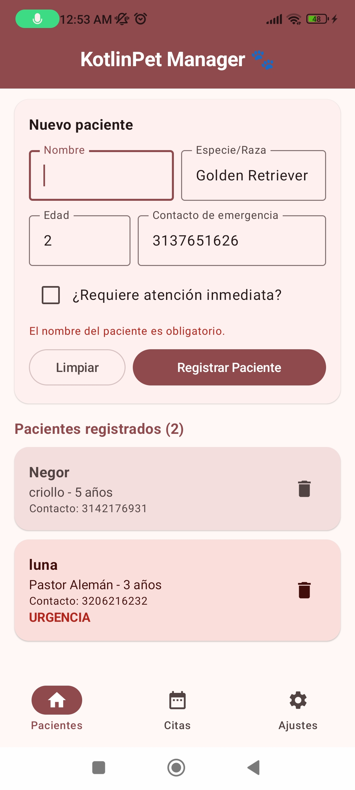

# KotlinPet Manager 🐾

**Estudiante:** [Maicol Stevan Alzate Munoz]
**Código:** [1112098588]
**Asignatura:** Desarrollo de Aplicativos Móviles (EE053)
**Proyecto 1:** App "KotlinPet Manager" v1.0

## Descripción

KotlinPet Manager es una app Android hecha con Kotlin, Jetpack Compose y Material 3 para registrar y consultar los pacientes de una clínica veterinaria. Usa arquitectura MVVM y muestra los pacientes en tarjetas que se actualizan en tiempo real.

## Captura de pantalla

